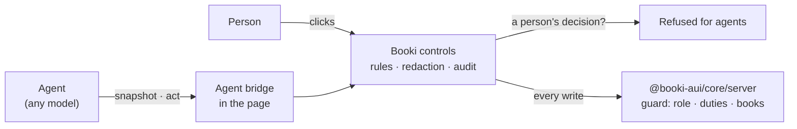

<div align="center">

<a href="https://booki.dev"></a>

# Booki

### Agent-first UI for accounting and auditing.

<a href="https://github.com/Walgermo/booki/actions/workflows/ci.yml"></a>
<a href="https://github.com/Walgermo/booki/actions/workflows/ci.yml"></a>
<a href="LICENSE"></a>


**[Website](https://booki.dev)** · **[Docs](https://booki.dev/docs)** · **[Live demo](https://booki.dev/demo)** · **[Example app](examples/ap-flow)** · **[Agent Contract](spec/agent-contract.md)**

</div>

<br>

<picture>
  <source media="(prefers-color-scheme: dark)" srcset=".github/readme/agent-at-work-dark.png">
  
</picture>

<br>

**Booki is a set of accounting controls an agent can operate and cannot misuse: amounts, vouchers, invoices, payments, bank reconciliation, approvals and audit work, for React, with experimental Vue, Svelte, Solid and plain HTML support.**

Agents already work in accounting software by reading the screen and typing
into text boxes. They guess which field is which, type `1.250,00` where the
system wanted øre, and press buttons that were meant for a person. Booki
replaces those fields with controls that give an agent typed state and named
accounting actions, enforce the bookkeeping rules whatever the agent sends,
and stop where a person has to decide. Your server checks the same rules again.

## Quick start

Booki is on npm as `@booki-aui/*`, before 1.0: the API may still change between
releases. What comes next is in [`ROADMAP.md`](ROADMAP.md).

To install it, run this in your app (it is one command, and the `@ui-sdk` versions are pinned):

```bash
pnpm add @booki-aui/core @booki-aui/react @booki-aui/styles @ui-sdk/core@0.1.0-beta.17 @ui-sdk/react@0.1.0-beta.17
```

**A minimum release age can refuse a new release.** Booki and its `@ui-sdk` packages
are new when they come out, and Booki pins the `@ui-sdk` packages exactly. An app with a
minimum release age (pnpm `minimumReleaseAge`, or Renovate's `minimumReleaseAge`) refuses
them for its first days, with `ERR_PNPM_NO_MATURE_MATCHING_VERSION`. Then either install the
previous Booki release, with the `@ui-sdk` version it pins, or ask the owner of the app for an
exception for exactly those versions, on a branch. Don't change the exact pin in `package.json`.

Add the `@ui-sdk` packages in the same command as Booki. Adding only one of them has made pnpm
drop the other from the lockfile.

**An unrelated package's Node `engines` entry can stop the install.** `pnpm add` rewrites the
lockfile, so it can fail with `ERR_PNPM_UNSUPPORTED_ENGINE` on a transitive dependency whose
`engines.node` doesn't list your Node version. That is your app's lockfile, not Booki: fix or
report that entry, and don't change Node for it. A way through: install once with
`--config.engine-strict=false`, then put your app's own edit of that `engines` entry back in
`pnpm-lock.yaml` by hand. `pnpm add` can restore the old range, so check with
`git diff pnpm-lock.yaml | grep engines`, then run `pnpm install --frozen-lockfile`.

Or give it to your coding agent:

- **In your app, with a coding agent:** load the skill, or copy the full setup
  prompt with the button on [booki.dev](https://booki.dev).

```bash
npx skills add Walgermo/booki --skill booki
```

- **In the browser:** [booki.dev/demo](https://booki.dev/demo) is a small
  accounting product built only from these controls, with an agent working
  each screen. [booki.dev/docs](https://booki.dev/docs) has every control with
  its live agent snapshot.
- **Locally**, with Node 26 and pnpm 11:

```bash
git clone https://github.com/Walgermo/booki.git && cd booki
```

```bash
pnpm install && pnpm dev
```

Open http://localhost:5173 for the docs and the demo.
`pnpm --filter @booki-aui/example-ap-flow dev` runs [the accounts-payable example](examples/ap-flow)
at http://localhost:3100, and `pnpm --filter @booki-aui/example-crm dev` [the sales CRM
example](examples/crm) at http://localhost:3200.

- **In your app, by hand:** the [installation guide](https://booki.dev/docs/installation)
  takes about five minutes. An existing Next.js and shadcn/ui product:
  [docs/drop-in.md](docs/drop-in.md).

## How it works

An agent never types into a field. It reads a snapshot of the screen and calls
named actions; the control enforces the rules, the page decides what needs a
person, and the server checks everything again.

```tsx
import { AmountField, VoucherComposer, createBookiAgent } from "@booki-aui/react"
import "@booki-aui/styles"

const agent = createBookiAgent()

await agent.act({
  steps: [
    { ref: "Amount excl. tax", action: "setMinor", args: [312500] },
    { ref: "Voucher lines", action: "assertPostable", args: [] },
  ],
})
```



The rules run twice: on screen for speed and clarity, and on your server as
the gate. `@booki-aui/core/server` checks the caller your sign-in established (a
person, or an agent with its own credential), its role, separation of duties
and the books, and answers with a status and the same sentence the control
showed:

```ts
import { guardPostVoucher, toHttp } from "@booki-aui/core/server"

const verdict = guardPostVoucher({ actor, locale: "nb" }, { lines, date, rules: { periods, accounts } })
const { status, body } = toHttp(verdict) // 200, or 401/403/409/422 with a reason
```

## What it guarantees

| Rule | How |
| --- | --- |
| Money is whole minor units | A fraction is refused at the action, before it reaches a voucher. |
| A voucher balances or it is not posted | `assertPostable` names the difference and any missing dimension. |
| Codes come from closed lists | Accounts, VAT codes, departments and projects. The error lists valid ones. |
| People approve what leaves the account | Approving, signing off, releasing and confirming are a person's, whatever the app allows. |
| Bank details stay unread | Account numbers, IBAN and KID read as `[redacted]` to an agent. |
| The agent's work is visible | A cursor, presence, proposals a person keeps or reverts, and a mark on what it set. |
| Closed periods stay closed | A voucher dated in a closed period is not postable; a locked period never reopens. |
| Approval takes the right people | Levels, amount limits and substitutes. The requester cannot approve; who approves a payment cannot release it. |
| A fixed invoice stays fixed | Totals come from the lines. After finalizing, corrections are credit notes. |

Booki is the first implementation of a draft specification, [the Agent Contract for Accounting
UIs](spec/agent-contract.md): what a screen gives an agent, what stays with a
person, how every step is recorded and how the server checks it again. Any
ERP can implement it; one agent then works across products. It is a draft with
one implementation; the [conformance suite in @booki-aui/readiness](packages/readiness/README.md#conformance-suite) lets you test your
own screens against it.

## Packages

Every control is defined once, without a framework, and generated for each
one, so a control has the same name, state, actions and rules everywhere and
one agent operates them all.

| Package | For |
| --- | --- |
| `@booki-aui/react` | React 19: the controls, the agent bridge, and the visible-agent pieces (`AgentCursor`, `AgentPresence`). |
| `@booki-aui/web` | Custom elements (`<booki-amount-field>`) for Angular, server-rendered pages and plain HTML (experimental). |
| `@booki-aui/vue` · `@booki-aui/svelte` · `@booki-aui/solid` | Vue 3.5, Svelte 5 and Solid 2, as parts (`AmountField.Root`, `AmountField.Input`) (experimental). |
| `@booki-aui/core` | The rules, with no framework: money, vouchers, reconciliation, approvals, period locks, close, invoices, payment batches, supplier invoices, expenses, ledger, aging, VAT returns, audit sampling, fixed assets, exchange rates, roles, validators, country profiles, and the server guard. |
| `@booki-aui/primitives` | Every control's definition with no framework: its state, its agent actions and the rules it enforces. |
| `@booki-aui/styles` | The optional default look, "Paper and Ink", as CSS variables (`DESIGN.md`). |

## Support

**Supported:**

- React 19 (`@booki-aui/react`, with `@booki-aui/core`, `@booki-aui/primitives` and `@booki-aui/styles`)
- The Norway (NO) and United States (US) country profiles

**Experimental:**

- Vue, Svelte, Solid and Web Components (`@booki-aui/vue`, `@booki-aui/svelte`, `@booki-aui/solid`, `@booki-aui/web`). They work and are generated from the same primitives, but they have less testing and their API may change between releases without notice.
- The Sweden (SE), Denmark (DK), United Kingdom (GB) and Germany (DE) starter profiles.

## Country profiles

Norway and the United States are supported country profiles. Sweden, Denmark,
the United Kingdom and Germany are experimental starter profiles; define your
own for the rest. No ERP connectors: your backend stays yours.

## Examples

- **[Supplier invoice to payment](examples/ap-flow)** (Next.js): inbox,
  approval, payment batch, release and bank reconciliation. Four people, an
  agent with its own credential, and a server guard on every write.
- **[A sales CRM](examples/crm)** (Next.js): pipeline board, deal value with its
  source, activity timeline, forecast, funnel, time in stage and recurring
  revenue, with an agent that runs common sales tasks and a server that keeps
  closing a deal for a person.
- **[The demo company](https://booki.dev/demo)**: an accounting product built
  only from Booki controls, with an agent on each screen (`apps/www`).
- **[A one-screen pilot](docs/pilot.md)**: two weeks to measure an agent on
  your own screen, before and after. `pnpm proof` runs the real-model numbers.

## For coding agents

- [`AGENTS.md`](AGENTS.md): how this repo works.
- [`DESIGN.md`](DESIGN.md): tokens, layout rules and what does not exist.
- [`packages/react/docs/llms.txt`](packages/react/docs/llms.txt): every control and its agent actions.
- The Booki skill: `npx skills add Walgermo/booki --skill booki`.

## Not covered yet

- Outside React, the controls come as parts: you write the markup around them. `AgentPresence` is React-only for now.
- Refusals are in English and Norwegian; a few messages from the React layer are English only.
- Sweden, Denmark, the UK and Germany are starter profiles with English labels.
- The VAT return ships example schemas only. You supply the real box layout.
- Intercompany eliminations, consolidation, budgets, payroll and dunning.
- Nothing connects to a bank, a tax authority or a document scanner: the host does.

## Contributing

Issues and pull requests are welcome. [`CONTRIBUTING.md`](CONTRIBUTING.md) has
the setup and the rules a review checks; `pnpm check` runs what CI runs.
The plan for v1 and after is in [`ROADMAP.md`](ROADMAP.md).
Versions and release notes come from Changesets ([`RELEASING.md`](RELEASING.md)).
Found a security problem? Report it privately ([`SECURITY.md`](SECURITY.md)).

## License

[MIT](LICENSE)
