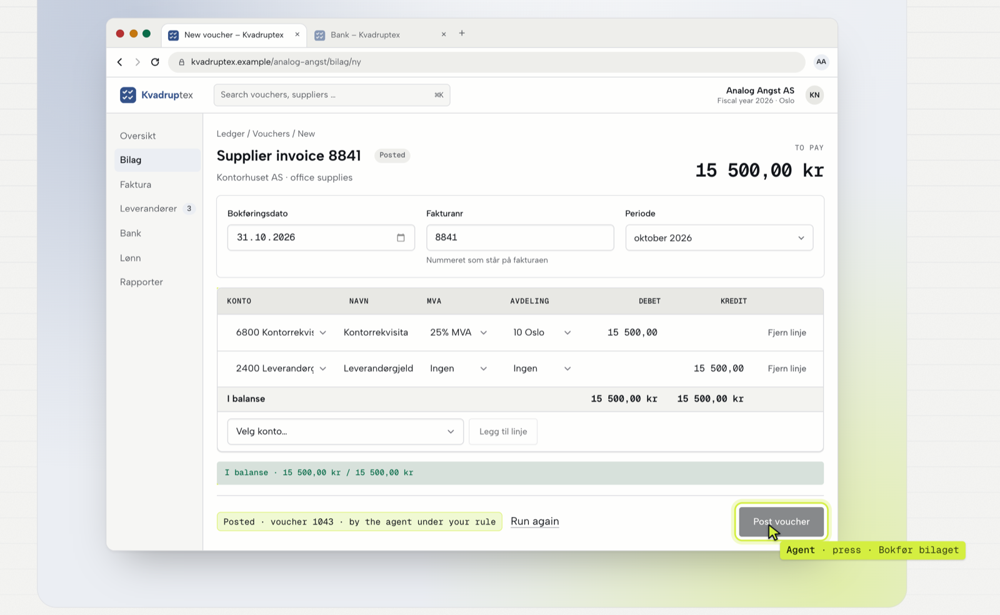
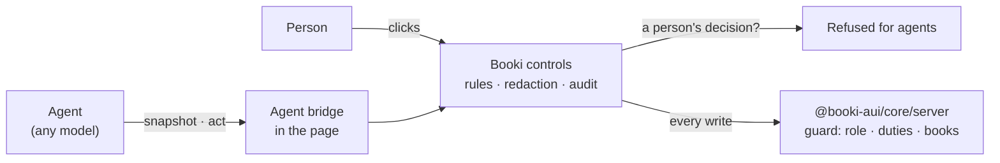

<div align="center">

<a href="https://booki.dev"></a>

# Booki

### Agent-first UI for your app.

<a href="https://github.com/Walgermo/booki/actions/workflows/ci.yml"></a>
<a href="https://github.com/Walgermo/booki/actions/workflows/ci.yml"></a>
<a href="https://www.npmjs.com/package/@booki-aui/react"></a>
<a href="https://www.npmjs.com/package/@booki-aui/react"></a>
<a href="https://github.com/Walgermo/booki/stargazers"></a>
<a href="LICENSE"></a>


**[Website](https://booki.dev)** · **[Docs](https://booki.dev/docs)** · **[Live demo](https://booki.dev/demo)** · **[Agent Contract](spec/agent-contract.md)**

</div>

**Booki is an open-source UI library that lets people and AI agents work in the same screens.**

Agents can read the state of a screen and use named actions to fill in a form,
update a sales pipeline, or propose an edit in a document. Your app decides
which actions are available and when a person needs to approve a change.

Use Booki's general-purpose controls for forms, tables, and documents, or build
on its specialized components for sales, accounting, and auditing.

<br>

<picture>
  <source media="(prefers-color-scheme: dark)" srcset=".github/readme/agent-at-work-dark.png">
  
</picture>

<br>

## Get started

**With a coding agent.** Copy the setup prompt with the button on
[booki.dev](https://booki.dev) and paste it into the agent in your app, or load
the skill:

```bash
npx skills add Walgermo/booki --skill booki
```

**By hand**, follow the [installation guide](https://booki.dev/docs/installation), or
[docs/drop-in.md](docs/drop-in.md) for an existing Next.js and shadcn/ui
product. If your app refuses the install (a minimum release age, a trust policy
or an `engines` entry), [the skill's install section](skills/booki/SKILL.md#1-install)
says what to do.

**Try it first** at [booki.dev/demo](https://booki.dev/demo): a small accounting
product built only from these controls, with an agent working each screen.

Booki is before 1.0, so the API may still change between releases. What comes
next is in [`ROADMAP.md`](ROADMAP.md).

## How it works

Through the Booki bridge, an agent reads a snapshot of the screen and calls
named actions. The control validates inputs, the app decides what needs a
person, and the server checks writes against your rules.

```tsx
import { createBookiAgent } from "@booki-aui/react"

const agent = createBookiAgent()

await agent.act({
  steps: [
    { ref: "Amount excl. tax", action: "setMinor", args: [312500] },
    { ref: "Voucher lines", action: "assertPostable", args: [] },
  ],
})
```



On the server, `@booki-aui/core/server` checks the caller your sign-in
established (a person, or an agent with its own credential), its role,
separation of duties and the books, and answers with a status and the same
sentence the control showed:

```ts
import { guardPostVoucher, toHttp } from "@booki-aui/core/server"

const verdict = guardPostVoucher({ actor, locale: "nb" }, { lines, date, rules: { periods, accounts } })
const { status, body } = toHttp(verdict) // 200, or 401/403/409/422 with a reason
```

## What it guarantees

| Rule | How |
| --- | --- |
| Money is whole minor units | A fraction is refused at the action, before it reaches a voucher. |
| A voucher balances or it is not posted | `assertPostable` names the difference and any missing dimension. |
| Codes come from closed lists | Accounts, VAT codes, departments and projects. The error lists valid ones. |
| People approve what leaves the account | Approving, signing off, releasing and confirming are a person's, whatever the app allows. |
| Bank details stay unread | Account numbers, IBAN and KID read as `[redacted]` to an agent. |
| The agent's work is visible | A cursor, presence, proposals a person keeps or reverts, and a mark on what it set. |
| Closed periods stay closed | A voucher dated in a closed period is not postable; a locked period never reopens. |
| Approval takes the right people | Levels, amount limits and substitutes. The requester cannot approve; who approves a payment cannot release it. |
| A fixed invoice stays fixed | Totals come from the lines. After finalizing, corrections are credit notes. |

Booki implements a draft specification, [the Agent Contract for Accounting
UIs](spec/agent-contract.md): what a screen gives an agent, what stays with a
person, how every step is recorded and how the server checks it again. The
[conformance suite in @booki-aui/readiness](packages/readiness/README.md#conformance-suite)
tests your own screens against it.

## Support

| Package | For |
| --- | --- |
| `@booki-aui/react` | React 19: the controls, the agent bridge, `AgentCursor` and `AgentPresence`. **Supported.** |
| `@booki-aui/core` | The rules with no framework, and the server guard. **Supported.** |
| `@booki-aui/primitives` | Every control's definition: state, agent actions and rules. **Supported.** |
| `@booki-aui/styles` | The optional default look, "Paper and Ink" ([`DESIGN.md`](DESIGN.md)). **Supported.** |
| `@booki-aui/icons` | 153 duotone icons for accounting, auditing and agent UI, in React or any framework ([browse](https://booki.dev/docs/icons)). **Supported.** |
| `@booki-aui/vue` · `svelte` · `solid` · `web` | The same controls for Vue, Svelte, Solid and custom elements. Experimental. |

Country profiles: Norway (NO) and the United States (US) are supported. Sweden,
Denmark, the United Kingdom and Germany are experimental starter profiles;
define your own for the rest. Experimental means it works and comes from the
same definitions, but has less testing and may change without notice.

## Examples

- **[Supplier invoice to payment](examples/ap-flow)** (Next.js): inbox,
  approval, payment batch, release and bank reconciliation, with an agent on
  its own credential and a server guard on every write.
- **[A sales CRM](examples/crm)** (Next.js): pipeline, activities, forecast and
  recurring revenue, with a server that keeps closing a deal for a person.
- **[The demo company](https://booki.dev/demo)**: an accounting product built
  only from Booki controls (`apps/www`).

## For coding agents

- [`AGENTS.md`](AGENTS.md): how this repo works.
- [`DESIGN.md`](DESIGN.md): tokens, layout rules and what does not exist.
- [`packages/react/docs/llms.txt`](packages/react/docs/llms.txt): every control and its agent actions.

## Not covered yet

- Outside React, the controls come as parts: you write the markup around them. `AgentPresence` is React-only for now.
- Refusals are in English and Norwegian; a few messages from the React layer are English only.
- The VAT return ships example schemas only. You supply the real box layout.
- Intercompany eliminations, consolidation, budgets, payroll and dunning.
- Nothing connects to an ERP, a bank, a tax authority or a document scanner: the host does.

## Contributing

Issues and pull requests are welcome. With Node 26 and pnpm 11:

```bash
git clone https://github.com/Walgermo/booki.git && cd booki
pnpm install && pnpm dev
```

The docs and demo run at http://localhost:5173. [`CONTRIBUTING.md`](CONTRIBUTING.md)
has the rules a review checks, and `pnpm check` runs what CI runs. Releases:
[`RELEASING.md`](RELEASING.md). Security problems: [`SECURITY.md`](SECURITY.md).

## License

[MIT](LICENSE)
